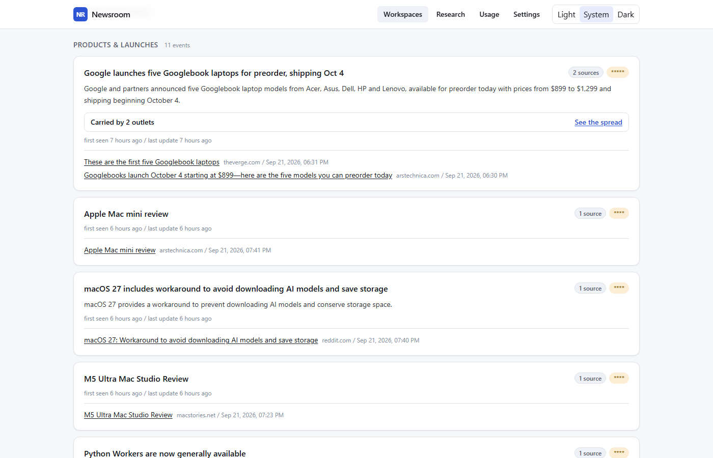
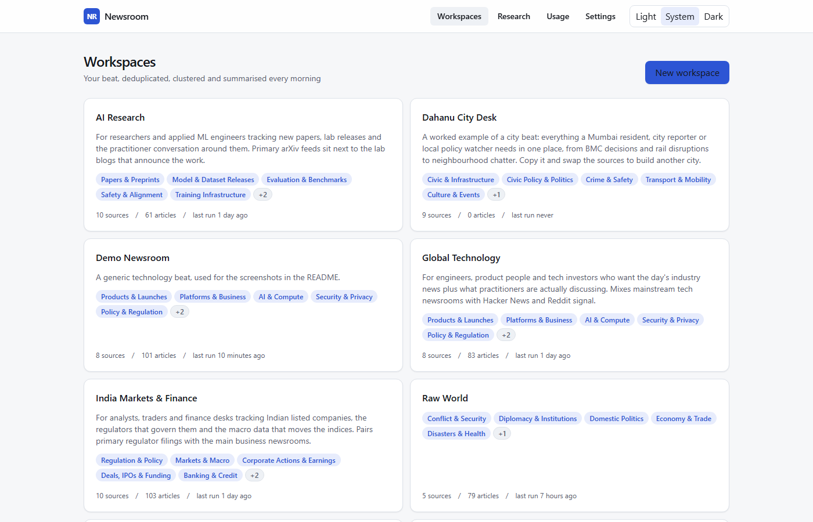
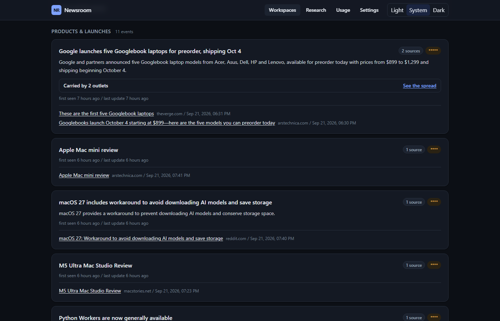
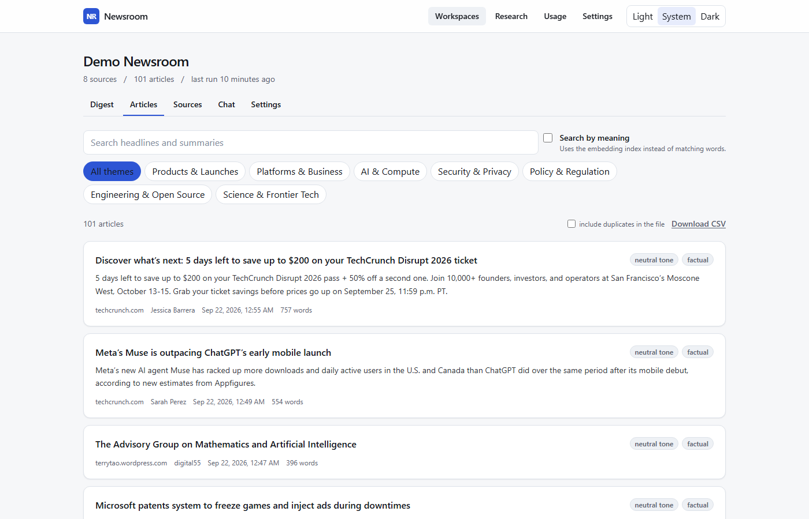
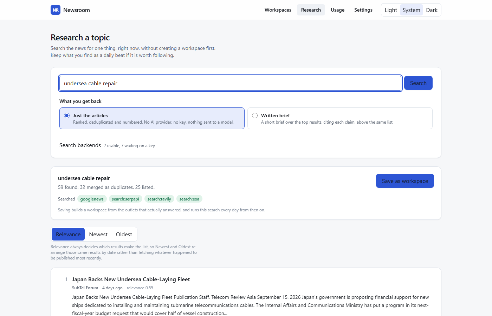
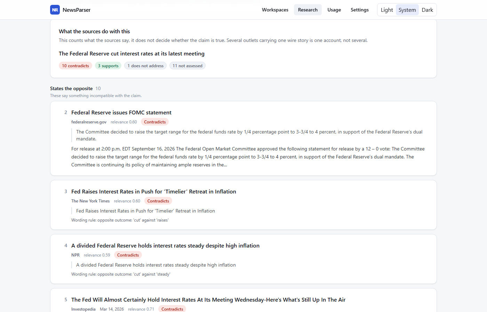
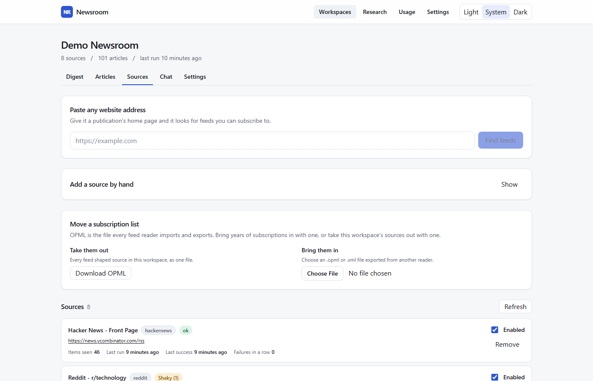
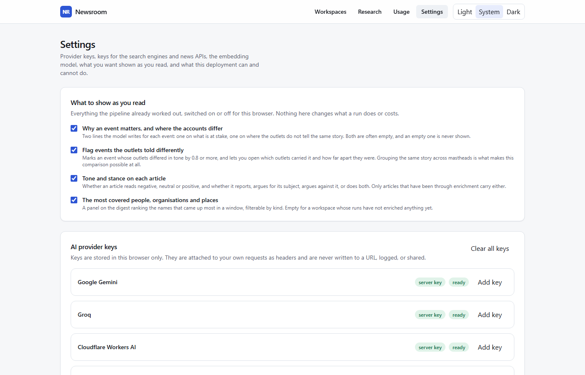
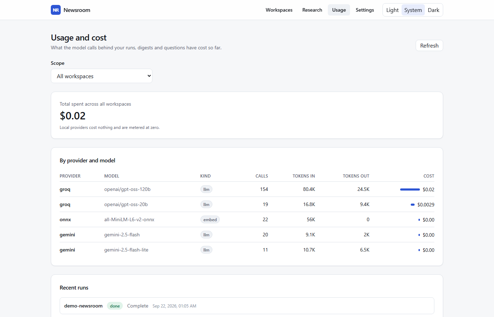

# Newsroom

A news aggregator that reads your sources so you do not have to open twelve
tabs. It pulls from RSS, sitemaps, aggregators and APIs, works out which
stories are the same story, groups what is left into events, and writes a short
daily digest with the links attached.

It runs with **no API keys at all**. Deduplication uses a 23 MB sentence
encoder bundled into the deployment, not a hosted service. Adding one LLM key
upgrades the digest from headlines to written summaries.



---

## Contents

- [What it actually does](#what-it-actually-does)
- [Quick start](#quick-start)
- [Reading a beat](#reading-a-beat)
- [Researching one topic](#researching-one-topic)
- [Getting the digest out](#getting-the-digest-out)
- [Deploying](#deploying)
- [How deduplication works](#how-deduplication-works)
- [Sources](#sources)
- [Providers and keys](#providers-and-keys)
- [Configuration](#configuration)
- [Command line](#command-line)
- [Tuning and evaluation](#tuning-and-evaluation)
- [Architecture](#architecture)
- [Known limits](#known-limits)

---

## What it actually does

The pipeline has ten stages. Each one is bounded and resumable, which is what
lets the whole thing run inside a 300 second serverless function as well as on
a machine with no time limit.

```
ingest    read every configured source, respecting robots.txt and rate limits
extract   fetch each article's full text, because feed summaries are thin
embed     turn each article into a vector
dedup     drop articles that are the same story as one already held
cluster   group the survivors into events, one event per real world happening
classify  assign each event a theme from this workspace's own taxonomy
summarise write a short factual account of each event from its coverage
digest    assemble the bullets, Markdown, HTML and JSON
enrich    entities, sentiment and stance (optional, runs last on purpose)
deliver   email, Slack, Discord, Telegram or a webhook, when you ask for it
```

A **workspace** is one beat: its own sources, its own theme taxonomy, its own
schedule. Eight presets ship ready to use, every feed in them verified live.

One real run of the shipped `global-tech` preset against the live web:

```
8 sources, 7 answered       100 articles seen, 98 new
67 full texts extracted     101 embedded
89 events                   89 summarised
digest: 6 bullets across 7 themed sections
```

---

## Quick start

Requires Python 3.12 and Node 20 or newer.

```bash
git clone https://github.com/spearb0lt/News-Research.git newsroom && cd newsroom

python -m venv .venv
source .venv/bin/activate      # Windows: .venv\Scripts\activate
pip install -r requirements.txt
python scripts/fetch_model.py  # 23 MB, the local encoder

npm install
cp .env.example .env           # optional, it runs without one
```

Two terminals:

```bash
uvicorn server.main:app --reload --port 8000   # backend
npm run dev                                    # frontend on :3000
```

Open <http://localhost:3000>, pick a preset, press **Run now**.



Or skip the browser entirely:

```bash
python -m server.ops.cli create global-tech
python -m server.ops.cli run global-tech
python -m server.ops.cli digest global-tech
```

Check what your machine can do at any point:

```bash
python -m server.ops.cli doctor
```

> Do not run `npm run build` while `npm run dev` is running. Both write to
> `.next`, and the production build replaces chunks the dev server still holds
> open. If you see `Cannot find module './331.js'`, stop both and remove
> `.next`.

---

## Reading a beat

Every workspace has the same five tabs.

**Digest** is the default: events grouped under the workspace's own themes,
each showing which outlets carried it, when it was first seen, and where the
accounts diverge. Sort by top stories, newest or oldest.



**Raw** is the same window with no editorial layer: every article, numbered,
sorted by date, deduplicated but not summarised. Switch it per view, or set
`ai_enabled: false` on the workspace to make it permanent. A raw workspace never
calls a language model, so it costs nothing and needs no key. Deduplication
still runs, because that is the part that uses the local encoder.



**Sources** lists what the beat reads, with each source's last result and its
error if it has one. Paste any website address and it finds that site's feeds
for you. OPML imports and exports here, so a reader's whole subscription list
moves in one step.

**Chat** answers questions against what this workspace has actually collected
and quotes the articles it used. It retrieves by embedding similarity over the
stored text, so it can only tell you what the beat ingested.

**Settings** holds the theme taxonomy, the keyword rules, the display toggles
and automatic delivery.

### Keywords

Each workspace carries three lists. **Exclude** drops a story at ingest, before
anything is spent on it. **Boost** lifts a story up the digest without hiding
anyone else's. **Include** is a whitelist: when it is not empty, everything that
does not match it is dropped.

The shipped presets use exclude and boost only. An include list layered on top
of feeds that are already topical throws away most of the beat, which is worth
knowing before you add one.

---

## Researching one topic

The digest answers "what happened on my beat today". Research answers "what is
there about this, right now", without creating a workspace first.



It fans out across every usable backend at once, Google News plus each search
provider you hold a key for, merges the duplicates, fetches the article text,
and ranks what is left against the query. Three modes:

- **Just the articles.** Ranked, deduplicated and numbered. No model is called,
  so this needs no AI key at all.
- **Written brief.** A short cited summary over the top results, with the same
  numbered list underneath it.
- **Check a claim.** Type an assertion rather than a topic and see what each
  source does with it.

Results sort by relevance, newest or oldest. Relevance always decides which
results make the list; the date options re-order those same results rather than
fetching whatever happened to be published most recently.

**Save as workspace** turns a search into a daily beat, built from the outlets
that actually answered it.

### Checking a claim

Give it a sentence rather than a subject and it groups the sources by what they
do with it: state the opposite, support it, or say nothing either way.



**It does not tell you whether the claim is true, and that is deliberate.** It
counts sources and shows the line each verdict rests on, because a count of
coverage is evidence and a verdict is a judgement. Eight outlets running one
wire story is one account, not eight confirmations, and nothing here can tell
the difference.

Two things do the reading:

- **The contradiction guard**, the same rules that stop the pipeline merging a
  rate hold with a rate cut. Deterministic, and it names the wording it
  matched, so you can disagree with it. It only recognises explicit opposites,
  so it is silent far more often than not. This needs no key.
- **A model**, when one is configured, which reads each article and quotes the
  sentence it judged on.

With no AI key at all the guard runs alone and everything it does not flag is
reported as **not assessed** rather than as agreement. Silence is not support.
Where the two disagree the model decides, because it read both texts while the
guard only matched vocabulary, and the guard's finding is still shown against
the article.

---

## Getting the digest out

| Route | What you get |
| --- | --- |
| Digest page, **Export** | Markdown, PDF, CSV or JSON |
| `/api/workspaces/{slug}/feed.xml` | The digest as an RSS feed |
| `/api/workspaces/{slug}/articles.csv` | Every article as a spreadsheet |
| `/api/workspaces/{slug}/sources.opml` | The source list, for any feed reader |
| Delivery | Email, Slack, Discord, Telegram, custom webhook |

Delivery can also happen by itself after a scheduled run. It is **off by
default**, because a fresh clone that started mailing people would be a
surprise. Turn it on with `AUTO_DELIVER=1` and set the channel and recipient,
either in the environment or per workspace in its settings.

A channel that is not configured says so. It does not fail silently, and it
does not try to send to an address meant for a different channel.

---

## Deploying

### Vercel

One project serves both halves: Next.js from the repo root, FastAPI from
`api/index.py`.

1. Create a free Postgres database. Vercel's marketplace offers Neon and
   Supabase; either free tier is ample. **The filesystem on Vercel is
   ephemeral, so a database URL is not optional there.**
2. Import the repository. Vercel detects Next.js and the Python function on its
   own; `vercel.json` is already configured.
3. Set environment variables: `DATABASE_URL`, `CRON_SECRET` (any long random
   string), and whichever provider keys you have.
4. Add a build step so the local encoder ships with the function. In project
   settings set the install command to:
   ```
   pip install -r requirements.txt && python scripts/fetch_model.py --quiet && npm install
   ```

The bundle comes to roughly 310 MB against Vercel's 500 MB Python limit.

**One thing to know about the free plan:** Hobby accounts allow cron jobs only
**once per day**, and a deployment fails to build if `vercel.json` asks for more.
A run that pauses at the 300 second limit therefore needs something to continue
it. `.github/workflows/scheduler.yml` does this for free: it starts the daily
run and pokes `/api/cron/tick` every fifteen minutes, which is a no-op when
nothing is waiting. Add `APP_URL` and `CRON_SECRET` as repository secrets and it
works. On Vercel Pro you can delete that workflow and schedule both in
`vercel.json` directly.

Once `CRON_SECRET` is set the scheduler routes refuse any request without it,
so they are safe to leave exposed.

### Docker, Oracle Cloud, Render, any VM

The container is the full featured target. Everything Vercel cannot do,
headless browser rendering, the PyTorch encoder, unbounded crawls, an in
process scheduler, switches on automatically because the runtime detects a
server tier.

```bash
docker compose up -d                    # app plus Postgres
docker compose --profile local-ai up -d # also Ollama, for a zero key setup
```

Oracle's Always Free ARM instance (2 OCPU, 12 GB as of 2026) runs this
comfortably. Install Docker, clone, `docker compose up -d`, and add a crontab
entry:

```cron
0 1 * * * cd /opt/newsroom && docker compose run --rm cron
```

`render.yaml` is a working blueprint for Render. Note that Render's free tier
spins down after 15 minutes of inactivity and offers no cron at all, so use the
GitHub Actions workflow there too.

### Postgres

Set `DATABASE_URL` and the same schema is created there instead of SQLite. The
data layer is written once: queries use `?` placeholders and are rewritten for
Postgres, and every timestamp is ISO 8601 UTC text rather than a native date
type, so behaviour does not drift between the two engines. SSL is required for
a remote host and not forced for a local one, which is what a container on the
same machine needs.

---

## How deduplication works

This is the part worth understanding, because it is where the project earns its
keep and where the interesting failure lives.

Four layers run in increasing order of cost:

1. **Canonical URL.** Tracking parameters, AMP suffixes, `www.`, `m.` and
   fragments are stripped before hashing, so `example.com/story?utm_source=x`
   and `www.example.com/story/` are one article, not two.
2. **Content hash.** Catches a byte identical reprint.
3. **SimHash.** A 64 bit locality sensitive fingerprint over word trigrams.
   Catches syndicated wire copy each outlet lightly reworded. No model involved.
4. **Embedding cosine.** Catches independent reporting of the same event.

### The contradiction guard

Layer 4 has a measured weakness that a threshold alone cannot fix. On the
bundled encoder:

| pair | cosine |
| --- | --- |
| same event, two outlets | 0.76 |
| **opposite** event, same subject ("RBI holds" vs "RBI cuts") | **0.69** |
| unrelated | 0.12 |

Seven hundredths is not a safe margin. Set the threshold low enough to catch
real duplicates and you will eventually merge a rate hold with a rate cut and
write one summary asserting both.

So before any merge, the two texts are checked for disagreement:

- **Mutually exclusive outcomes.** Eight families of verbs and adjectives:
  hold/cut/hike, approve/reject, win/lose, rise/fall, acquit/convict,
  resign/appoint, launch/halt, profit/loss. A pair picking different sides of
  one family is never merged, whatever the cosine says.
- **Disagreeing headline figures.** Percentages, basis points and amounts. A 12
  percent profit rise and a 30 percent profit rise are different stories.
- **Headline word overlap.** A high cosine with almost no shared headline words
  is the encoder being generous about topic, not evidence of one event.

On the shipped eval set this takes precision from 0.83 to 1.00, and the report
names every merge the guard prevented.

### Thresholds are per backend, not global

A sentence encoder and the lexical fallback produce completely different
similarity scales. A true duplicate pair scores about 0.76 on the ONNX model and
about 0.43 on the lexical fallback. Each backend therefore declares its own
cuts, and `DUPLICATE_THRESHOLD` / `CLUSTER_THRESHOLD` in the environment
override **all** of them with one number, which is almost never what you want.
Leave them unset unless you have run the eval.

---

## Sources

Eighteen source kinds. All work with no key except where noted.

| Kind | What it reads |
| --- | --- |
| `rss` | Any RSS, Atom or RDF feed. Sends conditional requests, so a feed that has not changed costs nothing |
| `sitemap` | `sitemap.xml`, sitemap indexes, Google News sitemaps |
| `html` | Any section or homepage, with article links scored and extracted |
| `googlenews` | Google News RSS search and topic feeds |
| `hackernews` | The official Firebase API, no rate limit |
| `youtube` | Channel and playlist feeds. A channel address, a bare `@handle` or a `UC...` id all work |
| `search` | SerpAPI, Brave, Tavily, Exa, or self-hosted SearXNG |
| `reddit` | Needs OAuth credentials (see below) |
| `browser` | Playwright rendering for JavaScript-heavy sites. Server tier only |
| `newsapi` `gnews` `newsdata` `currents` `mediastack` `guardian` `nyt` `marketaux` `finnhub` | Each needs its own key |



Paste any website address into the **sources** page and it will find that site's
feeds for you, from `<link rel="alternate">` tags and by probing common paths.
An address that is not a working feed is refused when you add it, rather than
being stored and reported as a fetch failure once a day forever.

**Reddit changed in 2026.** The unauthenticated `.json` endpoints now return
403, so a script-type OAuth app at <https://www.reddit.com/prefs/apps> is
required. Set `REDDIT_CLIENT_ID`, `REDDIT_CLIENT_SECRET` and a properly
formatted `REDDIT_USER_AGENT`.

### Politeness

Every outbound request goes through one client that observes a per-host delay
and any declared crawl delay, sends conditional requests (a feed that has not
changed returns 304 and costs nothing), and caps response size.

`robots.txt` is enforced where it applies: the `html` and `browser` crawlers,
and full-text article extraction. It is **not** applied to feeds, sitemaps and
documented JSON APIs. That is deliberate. `robots.txt` governs a crawler
discovering content it was not pointed at; a feed is published expressly for
machines and was configured by the person running the app, no feed reader
consults `robots.txt` before fetching a subscription, and enforcing it there
breaks official APIs. `export.arxiv.org` disallows the exact path its own
documented API lives on, so a strict reading silently killed three arXiv
sources until this distinction was drawn.

`RESPECT_ROBOTS=0` disables the remaining checks too. Only use it for sites you
have permission to read.

Some publishers block automated clients outright. Those sources report the
error and disable themselves after eight consecutive failures rather than
burning part of every run's time budget forever.

---

## Providers and keys

Nineteen LLM providers and eleven embedding backends, all interchangeable at
runtime.

**LLM:** Gemini, Groq, Cloudflare Workers AI, OpenRouter, Cerebras, SambaNova,
Mistral, DeepSeek, Together, Fireworks, Anthropic, OpenAI, xAI, Perplexity,
Hugging Face, plus Ollama, LM Studio, llama.cpp and vLLM running on your own
machine.

**Embeddings:** the bundled ONNX MiniLM, Gemini, Cloudflare, Jina, Voyage,
OpenAI, Cohere, sentence-transformers, Ollama, Hugging Face, and a
dependency-free lexical fallback.

Selection is automatic: the best available backend wins, which on a fresh
install with no keys is the bundled model. `EMBEDDING_PROVIDER` pins one.
Embedding deliberately prefers a local backend over a hosted one even when the
hosted one scores higher, because embedding runs once per article every day and
nobody expects adding a summarisation key to start spending quota on the
highest volume call in the pipeline.

### Bring your own key

Every API the app can use takes a key from the browser, not only the model
providers. That is eighteen credentials in four groups: web search, news APIs,
social and video, and the embedding-only providers.



Keys are held in `localStorage`, sent as `X-LLM-Key-<slug>` headers with that
visitor's own requests, and never written to a URL, logged, stored or shared.
That is what makes it safe to host this publicly without paying for everyone's
inference. Set `ALLOW_CLIENT_KEYS=0` for a private instance.

Cloudflare needs **both** a token and an account id, because the account id is
part of the request URL.

### What it costs

Every model call is metered by provider, model, token count and price, and the
usage page adds it up. A call to a model with no published price is reported as
unpriced rather than as free, because a zero in a cost column is a claim.



---

## Configuration

Everything is environment variables; see `.env.example`, which is annotated.
Nothing is required. A missing key means the matching provider or source
reports itself unavailable with a reason, and the app carries on.

The settings page shows a live capability panel explaining exactly what this
particular deployment cannot do and why, which is the fastest way to understand
a restriction.

---

## Command line

```bash
python -m server.ops.cli doctor            # capabilities, providers, source health
python -m server.ops.cli presets           # what beats are available
python -m server.ops.cli create india-markets
python -m server.ops.cli run india-markets
python -m server.ops.cli run-all           # what the cron container runs
python -m server.ops.cli tick              # continue a paused run
python -m server.ops.cli digest india-markets --deliver email --to me@example.com
```

---

## Tuning and evaluation

```bash
python -m server.ops.eval           # score the built in labelled set
python -m server.ops.eval --sweep   # every threshold from 0.20 to 0.98
```

The twelve shipped cases are deliberately adversarial; most are pairs that any
embedding model scores highly and only the guard separates. The shipped set
scores F1 1.000, and the run prints every merge the guard prevented.

A set shipped in a repository can only be a sanity check. To tune against your
own beat:

```bash
python -m server.ops.eval --workspace india-markets --sample 40 --out pairs.json
# set "same_event" to true or false on each pair
python -m server.ops.eval --labelled pairs.json
```

It exports the genuinely borderline pairs, the ones near the current cut, since
those are the only ones whose labels change anything.

---

## Architecture

```
server/
  runtime.py      detects serverless vs server, exposes a capability matrix
  settings.py     every environment variable
  credentials.py  every non-model API key, described for the UI
  util.py         URL canonicalisation, SimHash, time parsing
  db/             one schema over SQLite and Postgres
  llm/            19 providers, per-request keyring, strict routing
  embeddings/     11 backends, per-backend thresholds, similarity
  ingest/         18 source adapters, one polite HTTP client
  pipeline/       the ten stages and the resumable runner
  research.py     one-shot topic search across every backend at once
  claims.py       what each source does with one stated claim
  delivery/       email, Slack, Discord, Telegram, webhooks, RSS, file export
  rag/            semantic search and grounded question answering
  ops/            cost meter, CLI, evaluation
  presets/        eight ready-made beats
api/index.py      Vercel entrypoint
app/ components/ lib/   Next.js frontend
```

`runtime.py` is the keystone. Rather than fork the code for serverless, every
module asks it for permission, and a feature that cannot run reports itself
unavailable with a reason the UI shows. Adding a hosting target means teaching
`detect()` about it, not editing the pipeline.

The database stores every timestamp as ISO 8601 UTC text and writes queries
with `?` placeholders, rewritten for Postgres. That keeps one data layer honest
across both engines.

---

## Known limits

- **Summaries are machine written.** Every digest entry carries its source
  links, and the prompts forbid asserting anything not in the supplied text,
  but follow the links before relying on one. An event whose coverage supports
  nothing beyond its headline gets no summary rather than a padded one.
- **Clustering splits developing stories sometimes.** Coverage arriving hours
  apart with different framing can land just under the threshold and become two
  events. Lowering `CLUSTER_THRESHOLD` fixes it and costs precision; measure
  with the eval before changing it.
- **The contradiction guard is English and rule based.** It covers the outcome
  vocabulary that matters most in finance, law and politics. It will not catch
  a contradiction phrased in a way it has no word for.
- **A claim check is only as good as what the search returned,** and a claim
  carrying a specific date or figure is judged strictly: an article that states
  the substance but omits the qualifier is sometimes counted as not addressing
  it. State the claim plainly for the most useful answer, and read the quoted
  lines rather than the tally.
- **Research results are often undated.** Search APIs frequently return no
  publication date, so sorting a research run by date orders only the results
  that carried one.
- **Free tiers are small.** NewsAPI allows 100 requests a day and is
  localhost-only; GNews gives 10 articles per request with a 12 hour delay;
  Mediastack allows 100 requests a *month*. The keyless sources (RSS, sitemaps,
  Google News, Hacker News) carry the project and have no such limits.
- **Some publishers block automated clients.** Reuters and AP no longer
  publish usable public feeds at all; the presets reach them through Google
  News queries instead. Roughly a sixth of article extractions are refused this
  way on a typical run, and those articles fall back to their feed summary.
- **Vercel Hobby crons run once a day.** See the deployment section.
